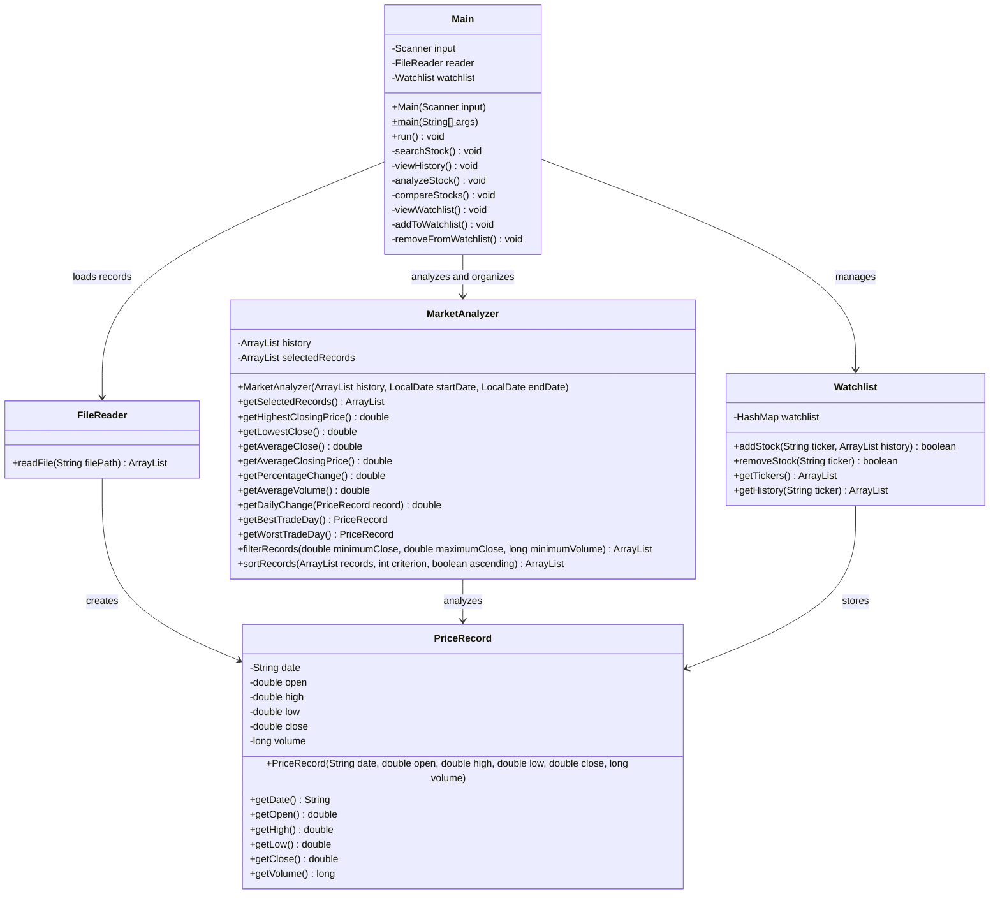

# Mini Market Terminal

Cassius Grimes - Wrote the MarketAnalyzer and Watchlist classes and worked on stock comparison, sorting, filtering, and the updated menu. Pipelore Rewaju - Wrote the FileReader class and worked on CSV validation, relative file loading, and user-input handling. Both worked on the PriceRecord and Main classes and integrated the Milestone Two features.

A Java console app that analyzes 2025 stocks from CSV files. Users can view historical prices, calculate stock statistics, compare stocks, maintain a watchlist, and sort or filter historical records.

## Run

Requires a Java JDK (8 or newer). Update the CSV folder path in `src/Main.java` to match your local `Market data_2025` folder, then run from the project directory:

'''
String path = "(your filepath here)/Market data_2025/"
                        + ticker + "_2025.csv";
'''

Keep the supplied `Market data_2025` folder in the project root. The program uses relative file paths, so no personal folder path needs to be changed.

Choose a feature from the menu. Enter dates in `YYYY-MM-DD` format and use 2025 dates for the supplied data. For stock comparison, enter at least two different tickers separated by spaces or commas. Enter `0` at the main menu to exit.

**Supported tickers:** AAPL, AMZN, AVGO, BRK, GOOGL, LLY, META, MSFT, NVDA, TSLA.

##UML Class Diagram

## UML Class Diagram

## Architecture

The Main class provides the console interface. It displays the menu, reads user input, calls the other classes, and displays historical records, analysis, comparisons, and watchlist information. It handles missing files, invalid tickers, invalid dates, and invalid date ranges.

The PriceRecord class stores the date, opening price, highest price, lowest price, closing price, and trading volume of a single day. Its constructor initializes these values, and getter methods provide access to them.

The FileReader class loads a ticker's CSV file, separates rows at the commas, converts numerical values, and returns an ArrayList of PriceRecord objects. It validates headers, column counts, dates, prices, volume, and duplicate trading dates.

The MarketAnalyzer class selects records within an inclusive date range and calculates closing-price statistics, percentage change, average volume, and the largest daily increase and decrease. It also filters records by closing price and volume and sorts them by date, closing price, or volume. Sorting uses a separate list so calculations remain chronological.

The Watchlist class uses a HashMap to store ticker symbols and their historical records. It supports adding, removing, and retrieving watched stocks while preventing duplicates. The watchlist lasts for the current program session.

Daily percentage changes compare a day's close with the previous available trading day's close. Days without a previous close are excluded. When no qualifying increase or decrease exists, the result displays N/A. Equal changes retain the earliest qualifying day.

## Testing Results

Milestone One

Milestone Two

